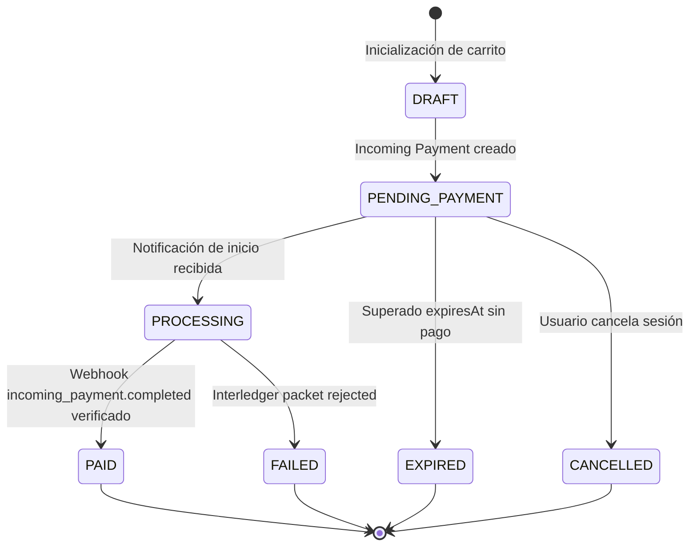

# Ciclo de Vida del Checkout con Open Payments

Este documento detalla los estados, transiciones y consideraciones operativas para sesiones de cobro de comercio usando Incoming Payments.

---

## 1. Diagrama de Transición de Estados de Orden

---

## 2. Invariantes de Conciliación de Cobros

1. **Unicidad de Recurso por Intento:**
   - Cada intento de pago o regeneración por caducidad debe generar un nuevo recurso `incoming-payment` con su propio identificador único en Open Payments.
   - Nunca reasignar un `incoming-payment` antiguo a una nueva orden.

2. **Montos Recibidos vs. Montos Esperados:**
   - El recurso de Open Payments registra `receivedAmount` acumulativo.
   - Un incoming payment con monto fijo se completa automáticamente al alcanzar el 100% del `incomingAmount.value`.
   - Pagos parciales mantienen el recurso en estado activo hasta alcanzar el total o llegar a la expiración.

3. **Manejo de Expiración (`expiresAt`):**
   - El tiempo de vida asignado al incoming payment debe ser suficiente para que el pagador revise y autorice la transacción en su propia interfaz bancaria o wallet.
   - Una vez expirado en Rafiki, cualquier cotización o transferencia ILP dirigida a dicho identificador será rechazada inmediatamente en la capa de liquidación.

---

## 3. Matriz de Eventos de Webhook y Efectos

| Tipo de Evento | Condición de Activación | Acción en Base de Datos Local |
| :--- | :--- | :--- |
| `incoming_payment.created` | Emisión del recurso en Rafiki | Registrar log de auditoría inicial |
| `incoming_payment.completed` | Totalidad del monto acreditada | Marcar orden como `PAID` y liberar despacho |
| `incoming_payment.expired` | Plazo cumplido sin completar monto | Marcar orden como `EXPIRED` |

---

## 4. Prácticas de Resiliencia en Checkout

- **Persistencia de Idempotencia:** Almacenar la relación `order_id` ↔ `incoming_payment_url` para responder de forma idempotente ante reintentos de inicialización de checkout dentro de la ventana de validez.
- **Seguridad en Frontends:** Ningún token de acceso GNAP ni secreto de firma debe transmitirse hacia el navegador web. El cliente únicamente recibe el identificador del incoming payment y metadatos públicos de presentación.
